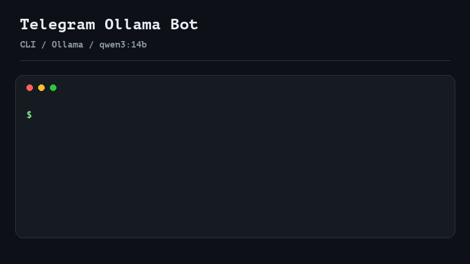

# Telegram Ollama Bot

Небольшой Telegram-бот, который передаёт вопросы в Ollama и возвращает ответы в чат. Python, стандартная библиотека, long polling.

Автор: [Марк / MDRK Studio](https://mdrkstudio.ru).



Анимированный пример режима `--ask` с реальным ответом Ollama (`qwen3:14b`). Отображение терминала воссоздано для читаемости, пауза сокращена. Вызов работает без Telegram-токена.

## Возможности

- Ответы модели через Ollama Chat API.
- Команды `/start`, `/help`, `/model`.
- Режим `--ask` для общения с моделью из терминала без Telegram.
- Преобразование Markdown в обычный текст и разделение длинных ответов.
- Настройки через переменные окружения, без токенов в исходниках.

## Запуск

Понадобятся Python 3.10+ и [Ollama](https://ollama.com/download). Дополнительные Python-пакеты не нужны.

Запусти Ollama и скачай модель. Например, если оборудование позволяет использовать Gemma 3 12B:

```bash
ollama pull gemma3:12b
python3 tg_demo_bot.py --ask "Объясни, что такое WebGL"
```

Можно выбрать другую доступную в Ollama модель через `OLLAMA_MODEL`. Требования к памяти зависят от модели.

Для Telegram создай собственного бота через [BotFather](https://t.me/BotFather) и задай токен в окружении:

```bash
export TELEGRAM_BOT_TOKEN="your_bot_token"
export OLLAMA_MODEL="gemma3:12b"
python3 tg_demo_bot.py
```

Остановка: `Ctrl+C`. Один экземпляр приложения должен обслуживать один токен. Если у бота настроен webhook, отключи его перед запуском long polling.

## Настройки

| Переменная | По умолчанию | Назначение |
| --- | --- | --- |
| `TELEGRAM_BOT_TOKEN` | Не задана | Токен собственного Telegram-бота. Не нужен для `--ask` |
| `OLLAMA_URL` | `http://localhost:11434` | Адрес Ollama |
| `OLLAMA_MODEL` | `gemma3:12b` | Имя установленной модели |

Файл `.env.example` содержит образец. Python не загружает `.env` автоматически. Для Bash/Zsh можно скопировать пример в `.env`, заполнить его и загрузить перед запуском:

```bash
cp .env.example .env
set -a
source .env
set +a
python3 tg_demo_bot.py
```

Токен хранится только у владельца бота. Файлы `.env` исключены из Git.

## Как устроен

`tg_demo_bot.py` получает обновления через Telegram Bot API, отправляет текст в `/api/chat` и возвращает ответ. В Ollama уходит текущий вопрос и системная инструкция. Диалоговая история не сохраняется.

Это компактный демонстрационный бот: запросы выполняются последовательно, потокового ответа, базы данных, ограничения доступа и очереди заданий нет. Системная инструкция ориентирована на русский язык, но качество и язык ответа зависят от выбранной модели. Пользовательские вопросы и ответы проходят через Telegram; адрес обработки моделью задаётся в `OLLAMA_URL`.

## Ссылки

[MDRK Studio](https://mdrkstudio.ru) · [Ollama](https://ollama.com) · [Telegram Bot API](https://core.telegram.org/bots/api)

## Лицензия

Авторский код проекта распространяется по [PolyForm Noncommercial 1.0.0](LICENSE). Разрешены некоммерческое использование, изменения и распространение в пределах условий лицензии. При распространении сохраняйте текст лицензии и уведомление из [NOTICE](NOTICE).

Для коммерческого применения, например в платном продукте или заказном проекте, нужно отдельное разрешение автора. [Связаться с MDRK Studio](https://mdrkstudio.ru/contacts).

Это source-available проект с некоммерческой лицензией. Сторонние зависимости и инструменты распространяются по своим лицензиям.
